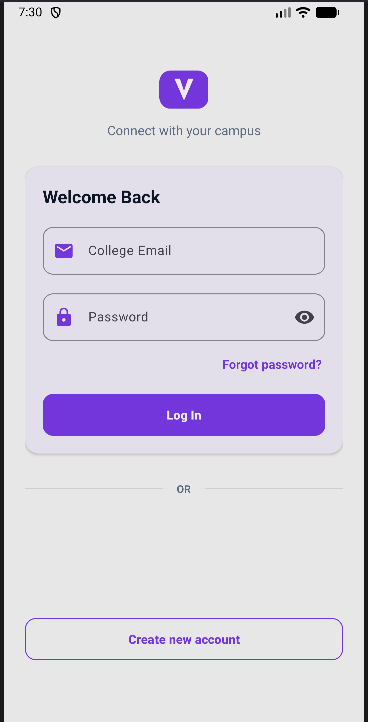
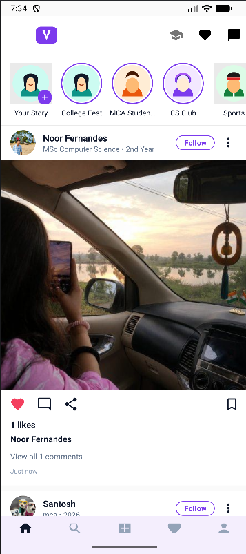
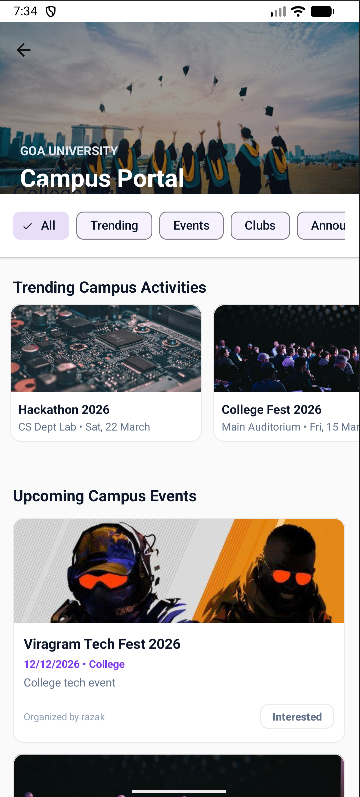
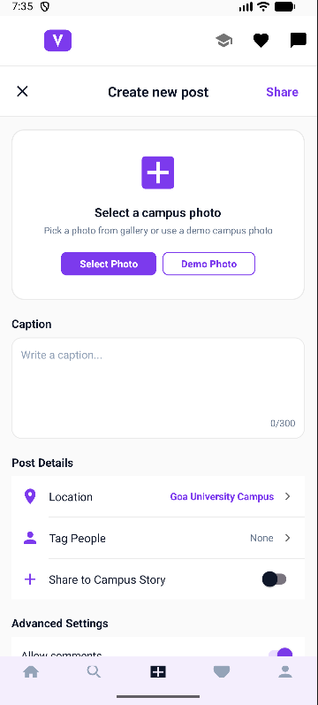
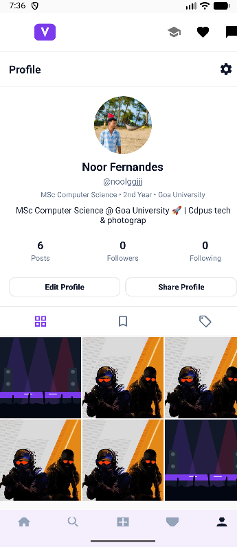
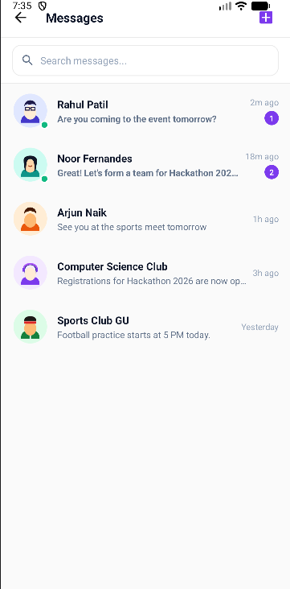
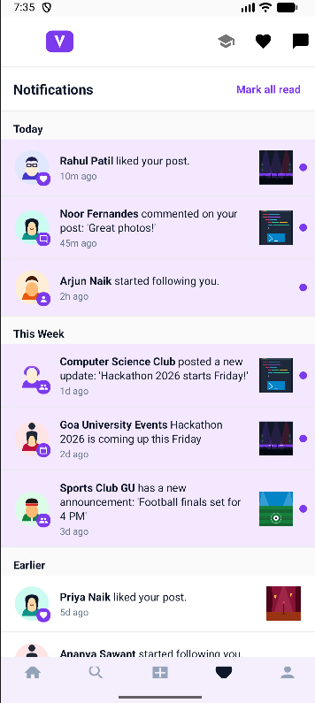

# Viragram – Your Campus Social Network

**Project Type:** Mini Project  
**Platform:** Android  
**Language:** Java  
**Backend/Services:** Firebase (Authentication, Cloud Firestore), ImageKit CDN  
**Student:** Razak Nadaf  
**Roll No:** 2638  

---

## 1. Project Overview

**Viragram** is an Android-based campus social networking and activity platform developed specifically for university students, faculty, and student-led clubs. Unlike generic social media networks, Viragram creates a closed, authenticated campus community where students can share campus moments, discover upcoming university events, participate in student clubs, exchange real-time direct messages, and receive official department announcements.

The application combines a rich social feed with an academic and club discovery hub, ensuring students remain engaged with campus life while staying informed about key college happenings.

---

## 2. Objectives

- **Campus-Centric Communication:** Eliminate fragmented WhatsApp groups and bulletin boards by centralizing campus interaction into a single mobile application.
- **Institutional Authentication:** Ensure a secure community by verifying student registrations using campus email credentials.
- **Activity & Event Discovery:** Provide a dedicated **College Hub** for discovering fests, hackathons, workshops, and sports tournaments.
- **Student Engagement:** Enable photo sharing, campus location tagging, interactive stories, post commenting, and liking.
- **Real-Time Messaging:** Offer direct student-to-student messaging and club communication channels with low latency.
- **Role-Based Club Administration:** Provide authorized club heads and administrators with dashboard tools to publish official announcements and manage club profiles.

---

## 3. Main Features

### 3.1 Student Experience
- **Authentication & Security:** Email/password registration, password recovery, and email verification.
- **Campus Home Feed:** Scrollable feed displaying campus posts, captions, location tags, and real-time like/comment counts.
- **Stories Bar:** Ephemeral 24-hour campus story updates displayed atop the home feed.
- **College Hub:** Categorized view for Trending Activities, Upcoming Campus Events, Official Clubs, and Department Circulars.
- **Post Creation:** Easy photo selection, caption composing, location tagging (e.g., Goa University Campus), and privacy toggles.
- **Direct Messaging:** One-on-one student chat with conversation history and unread message indicators.
- **Activity Notifications:** Push-style notification list for likes, comments, new followers, and college alerts.
- **Student Profile:** Customized profile showing student details (programme, year, bio), follower/following metrics, and personal post grid.

### 3.2 Administrative Features
- **Admin Dashboard:** Restricted view for authorized campus coordinators.
- **Event Creation & Scheduling:** Form to publish events with dates, locations, categories, and banner images.
- **Club Management:** Portal to register clubs and manage leadership contacts.
- **Announcement Broadcast:** High-priority notices displayed prominently across student feeds.

---

## 4. Technologies Used

| Layer | Technology | Details |
| :--- | :--- | :--- |
| **Mobile OS** | Android | Target SDK 34, Min SDK 26 (Android 8.0 Oreo+) |
| **Programming Language** | Java | Core Android application logic |
| **User Interface** | XML Layouts | Material Design Components, ConstraintLayout, CardView, RecyclerView |
| **Authentication** | Firebase Authentication | Email/password verification & session persistence |
| **Database** | Cloud Firestore | Real-time NoSQL database for posts, users, messages, and events |
| **Media Hosting** | ImageKit CDN / Cloud Storage | High-speed image optimization and delivery |
| **Image Loading** | Bumptech Glide | Image caching, placeholder management, and transformation |
| **Backend Utilities** | Node.js | Helper administrative scripts & custom claim management |
| **Build System** | Gradle (Kotlin DSL) | Dependency injection and build automation |

---

## 5. Project Structure

The project repository follows the standard college submission structure:

`	ext
Viragram/
│
├── code/                                # Complete working Android Studio source project
│   ├── app/                             # Android application module
│   │   ├── src/main/java/               # Java source packages (activities, adapters, models, fragments)
│   │   ├── src/main/res/                # XML layouts, drawables, values, colors, navigation
│   │   ├── src/main/AndroidManifest.xml # Application manifest and permissions
│   │   ├── build.gradle.kts             # App-level build and dependencies configuration
│   │   └── google-services.json         # Firebase client configuration
│   ├── gradle/                          # Gradle wrapper files
│   ├── build.gradle.kts                 # Root project build configuration
│   ├── settings.gradle.kts              # Module and repository settings
│   ├── gradle.properties                # JVM memory and build optimization flags
│   ├── firestore.rules                  # Firestore security rules
│   ├── server.js                        # Node.js backend helper server
│   └── .env.example                     # Environment template (no secrets exposed)
│
├── report/                              # Final Project Report
│   ├── Viragram_Project_Report.pdf      # 52-page comprehensive report with all UML diagrams
│   └── Viragram_Project_Report.docx     # Editable Word document copy
│
├── presentation/                        # Project Presentation
│   └── Viragram_Project_Presentation.pptx # 12-slide final project defense presentation
│
├── output/                              # Application Output & Media
│   ├── screenshots/                     # Real application screenshots
│   │   ├── 01_Login_Screen.png
│   │   ├── 02_Home_Feed.png
│   │   ├── 03_College_Hub.png
│   │   ├── 04_Create_Post.png
│   │   ├── 05_Profile.png
│   │   ├── 06_Messages.png
│   │   └── 07_Notifications.png
│   └── demo/                            # Application demonstration guide
│       └── README.md
│
└── README.md                            # Main project documentation
`

---

## 6. How to Run the Project

### Prerequisites
- **Android Studio:** Hedgehog / Iguana / Jellyfish / Ladybug (or newer)
- **JDK:** Java Development Kit 17 (recommended)
- **Android Device or Emulator:** Android 8.0 (API Level 26) or higher
- **Internet Connection:** Active connection for Firebase data sync

### Steps to Build and Run
1. **Clone the Repository:**
   `ash
   git clone https://github.com/RazakNadaf/Viragram.git
   cd Viragram
   `
2. **Open the Project in Android Studio:**
   - Launch Android Studio.
   - Click **Open** (or **File > Open**).
   - Select the code/ folder inside the Viragram directory.
3. **Gradle Sync:**
   - Allow Android Studio to automatically download dependencies and sync Gradle.
   - Verify that google-services.json is located in code/app/.
4. **Run the Application:**
   - Select your target device (physical device via USB or an AVD emulator).
   - Click the green **Run** button or press Shift + F10.

---

## 7. Screenshots

| 01. Login Screen | 02. Home Feed | 03. College Hub |
| :---: | :---: | :---: |
|  |  |  |

| 04. Create Post | 05. Profile Screen | 06. Messages | 07. Notifications |
| :---: | :---: | :---: | :---: |
|  |  |  |  |

---

## 8. Project Documentation

All academic documentation prepared for the final mini-project submission is organized inside the repository:

- **Project Report (PDF):** [
eport/Viragram_Project_Report.pdf](report/Viragram_Project_Report.pdf)  
  *Contains complete documentation across 52 pages, including System Requirements, Architecture, Database Schema, and all required UML diagrams:*
  - *Use Case Diagram*
  - *Class Diagram*
  - *Object Diagram*
  - *Sequence Diagram*
  - *Activity Diagram*
- **Project Presentation (PPTX):** [presentation/Viragram_Project_Presentation.pptx](presentation/Viragram_Project_Presentation.pptx)  
  *12-slide comprehensive presentation covering problem statement, system design, feature highlights, and future enhancements.*
- **Output Screenshots:** [output/screenshots/](output/screenshots/)  
  *High-resolution captures of the functional mobile interface.*
- **Demo & Testing Guide:** [output/demo/README.md](output/demo/README.md)  
  *Walkthrough flow and testing guidance.*

---

## 9. Team/Student Information

- **Student Name:** Razak Nadaf
- **Roll Number:** 2638
- **Course:** Master of Computer Applications (MCA)
- **Project Title:** Viragram – Your Campus Social Network
- **Academic Year:** 2026
